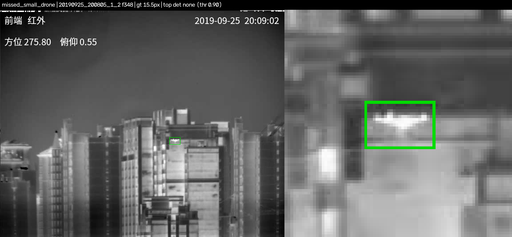

# Thermal Drone Detection

A detector for small drones in thermal (infrared) video: a COCO-pretrained Faster R-CNN fine-tuned on the public Anti-UAV300 set, compared with a training-free hot-spot detector, and tested on a second public dataset it never saw.

Built with AI coding agents (Claude, Codex); tests and verification by me.

> **Shortened first run.** Training stopped after 1 of 4 planned epochs, and every score comes from reduced samples (544 Anti-UAV test frames; one frame per video on the second dataset). Frames from the same video are correlated, so the 95% intervals in the result files are narrower than the real uncertainty. Read these numbers as a first estimate.



Missed small drone (15.5 px) against buildings. Green = label; the model drew no box above its threshold. Anti-UAV300 test, sequence 20190925_200805_1_2, frame 348.

## Results

Both methods were scored on the same frames. The score threshold was chosen once on Anti-UAV validation data (highest F1) and applied unchanged everywhere. Counts in brackets.

| Measure | Top-hat baseline (no training) | Fine-tuned Faster R-CNN | Source |
|---|---|---|---|
| Anti-UAV300 test AP@0.5 | 0.123 | 0.846 | `results/*/antiuav_metrics.json` |
| Precision | 13.6% (252 / 1,849) | 95.5% (340 / 356) | `results/*/antiuav_metrics.json` |
| Recall | 58.6% (252 / 430) | 79.1% (340 / 430) | `results/*/antiuav_metrics.json` |
| False-alarm rate on drone-free frames | 99.1% (113 / 114) | 2.6% (3 / 114) | `results/*/antiuav_metrics.json` |
| Svanström drone recall, all distances | 3.4% (5 / 149) | 40.9% (61 / 149) | `results/*/svanstrom_metrics.json` |
| Svanström drone recall, Close (< 20 m) | 8.7% (2 / 23) | 52.2% (12 / 23) | `results/*/svanstrom_metrics.json` |
| Svanström drone recall, Medium (20–60 m) | 3.4% (3 / 88) | 47.7% (42 / 88) | `results/*/svanstrom_metrics.json` |
| Svanström drone recall, Distant (> 60 m) | 0.0% (0 / 38) | 18.4% (7 / 38) | `results/*/svanstrom_metrics.json` |
| Bird frames flagged as drone | 74.0% (57 / 77) | 33.8% (26 / 77) | `results/*/svanstrom_metrics.json` |
| Aeroplane frames flagged as drone | 87.8% (65 / 74) | 48.6% (36 / 74) | `results/*/svanstrom_metrics.json` |
| Helicopter frames flagged as drone | 76.4% (42 / 55) | 52.7% (29 / 55) | `results/*/svanstrom_metrics.json` |

Model recall by target size, √(w·h), on the Anti-UAV test sample: 69.1% for 8–16 px (76 / 110), 73.5% for 16–32 px (72 / 98) and 80.4% for 32–64 px (258 / 321). Only six targets were under 8 px and the model found none of them. Source: `results/model/antiuav_metrics.json`. The full table, with Wilson intervals, is in `results/RESULTS.md`.

## How it was verified

- **Splits by source video.** The official Anti-UAV train and validation sets share 26 of their 27 source videos. They were merged and re-split by source video: 22 for training and 5 for validation. The official test set (91 sequences from 10 other source videos) was kept as it was. The split is in `results/data/antiuav_split.json`.
- **Label checks.** Each video's frame count was checked against its labels; five Svanström videos whose labels did not line up with their frames were excluded before any model was run.
- **One protocol for both methods.** A box counts as found if it overlaps a labelled drone with IoU ≥ 0.5. AP@0.5 is the area under the precision–recall curve. The false-alarm rate is the share of drone-free frames with at least one box above the threshold. The baseline's kernel, threshold and text mask were chosen on validation data only.
- **A dataset never used for training or tuning.** The Svanström et al. set (different camera and site) measures generalisation and how often birds, aeroplanes and helicopters set the detector off. Its distance bins follow the dataset's own labels.
- **Provenance.** Every result file records the configuration hash, the SHA-256 of each dataset archive and the git commit of the working repository at run time. That repository is private; this public repository starts from a fresh history, so those commits are not in it. The seed is fixed at 0.
- **Unit tests** cover IoU, average precision, duplicate detections and empty frames (`tests/test_metrics.py`).

## Limits

- One of four planned epochs. The learning-rate schedule was set for four epochs, so training stopped before the rate had decayed. These are not the model's best numbers.
- Reduced evaluation samples: 544 Anti-UAV test frames instead of 9,582, and one frame per video (360 frames) instead of every fifth frame on the second dataset. The baseline was also scored on all 9,582 test frames as a reference (`results/baseline_fullset_reference/`); the model was not.
- Frames from the same video are strongly correlated, so the 95% intervals in the result files assume more independent evidence than there is.
- Only six targets were under 8 px, too few for any conclusion about very small drones. Some missed small-target labels sit at the edge of the frame with no drone visible, so part of those misses may be labelling artefacts; they were not checked one by one.
- On the first frames of the bird videos the bird is often unlabelled, so only frame-level alarms could be measured, not whether the bird itself was boxed. The baseline's best validation setting lay on the edge of its search grid, so the baseline may be slightly understated.
- Both datasets come from specific cameras and sites, and the second one was recorded in daylight only. The results say nothing about other sensors, weather or operational use.

## Run it

Python 3.12. The unit tests need only NumPy and pytest; they use no data.

```sh
git clone https://github.com/hyh4867/thermal-drone-detection.git
cd thermal-drone-detection
python3 -m venv .venv && . .venv/bin/activate
python -m pip install -r requirements-test.txt
PYTHONPATH=src python -m pytest -q tests
```

The full pipeline needs the datasets (below, about 6 GB for Anti-UAV300) and `requirements.txt` (PyTorch and torchvision). It was not re-run for this repository; the commands are:

```sh
python -m pip install -r requirements.txt
# put the archives in data/raw/ and unpack them (IR frames only for Anti-UAV):
unzip Anti-UAV-RGBT.zip -x "*/visible.*" -d data/raw/antiuav300
unzip Drone-detection-dataset-v1.0.0.zip -d data/raw/svanstrom
export PYTHONPATH=src
python -m tdd.prepare_antiuav
python -m tdd.prepare_svanstrom
python -m tdd.baseline     # validation grid search and evaluation -> results/baseline/
python -m tdd.train        # -> runs/frcnn/best.pt (not committed)
python -m tdd.eval_model   # -> results/model/
python -m tdd.failures     # -> results/failures/
python -m tdd.report       # -> results/RESULTS.md
```

All paths are set in `configs/default.yaml`. Raw data, extracted frames and model weights are ignored by Git.

## Data, citation and licenses

The datasets are not redistributed here. Download them from their sources:

| Dataset | Use | Source | Terms |
|---|---|---|---|
| Anti-UAV300 (IR only) | Training, validation, test | [github.com/ZhaoJ9014/Anti-UAV](https://github.com/ZhaoJ9014/Anti-UAV) (Google Drive link in its README); `Anti-UAV-RGBT.zip`, SHA-256 `ed7d80bbd8ca8e01ea784c64eb0782eae8b3a1572177535c0fada9beb53fdca8` | The Anti-UAV project is released under the MIT License. |
| Svanström et al. multi-sensor drone dataset | Cross-dataset evaluation only | Zenodo [10.5281/zenodo.5500576](https://doi.org/10.5281/zenodo.5500576) v1.0.0; `Drone-detection-dataset-v1.0.0.zip`, SHA-256 `53deda08127dc7896e96454cf35e866e8d6bee336f25d290b26e1f5324e23c81` | Data repository under CC0 1.0 ("free to download, use and edit"). |

- Jiang et al., Anti-UAV: A Large Multi-Modal Benchmark for UAV Tracking, [arXiv:2101.08466](https://arxiv.org/abs/2101.08466).
- Svanström, Alonso-Fernandez & Englund, A dataset for multi-sensor drone detection, *Data in Brief* 39, 107521 (2021), [doi:10.1016/j.dib.2021.107521](https://doi.org/10.1016/j.dib.2021.107521) (article under CC BY 4.0).
- The images in `results/failures/` are single frames from these datasets with boxes drawn on them, shown with their source as above.
- Model: torchvision's Faster R-CNN with a ResNet-50 FPN backbone (BSD-3-Clause). The COCO-pretrained weights are downloaded by torchvision at run time; the fine-tuned weights are not published. Ultralytics YOLO was not used because it is AGPL-3.0, which would place copyleft obligations on this MIT-licensed project.
- Dependencies: PyTorch (BSD-style), torchvision (BSD-3-Clause), NumPy and pandas (BSD-3-Clause), OpenCV headless (Apache-2.0), Matplotlib (PSF-based), PyYAML, openpyxl, mcos-decoder and pytest (MIT).
- Code: MIT License, see `LICENSE`.
