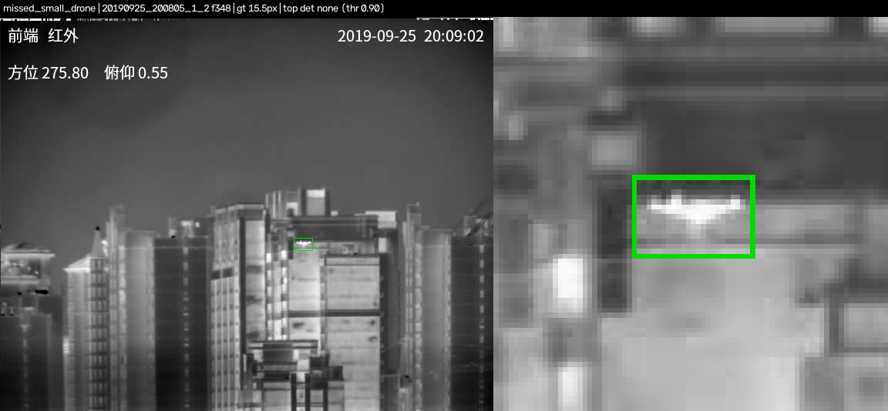

# Thermal Drone Detection

A detector for small drones in thermal (infrared) video: a COCO-pretrained Faster R-CNN fine-tuned on the public Anti-UAV300 set, compared with a training-free hot-spot detector, and tested on a second public dataset it never saw.

Built with AI coding agents (Claude, Codex); tests and verification by me.

> **Main finding.** On the dataset it was trained on, the detector finds 84.9% of drones. On a second dataset from a different camera and site, which was never used for training or tuning, it finds 48.6%, and only 17.6% beyond 60 m. Most of its alarms on bird, aeroplane and helicopter videos fall somewhere other than the labelled object.



> **Later stages (added 2026-11-22).** Stage 2 found that most of the recall drop above is a difference in how the two datasets draw their boxes, not missed drones: counted by whether the detection centre lies inside the label, recall on the second dataset is 85.9%. It also corrected finding 2 of stage 1 (most alarms on non-drone videos do sit on the labelled object). Stage 3 tested very small targets on a third camera: no improvement could be selected without data from that camera, and fine-tuning on 20 of its sequences helped there (AP@0.5 0.081 → 0.415) at a cost on the other two datasets. See *Stage 2* and *Stage 3* below. The stage 1 text is kept as it was written.

Missed small drone (15.5 px) against buildings. Green = label; the model drew no box above its threshold. Anti-UAV300 test, sequence 20190925_200805_1_2, frame 348. The failure images come from the first run's model (see *First run* below).

## Results

Final run: 4 training epochs, full evaluation sets. Both methods were scored on the same frames: all 9,582 Anti-UAV300 test frames (8,429 labelled drones, 1,153 drone-free frames) and every fifth frame of the second dataset. The score threshold was chosen once on the 1,596 Anti-UAV validation frames (highest F1) and applied unchanged everywhere. Counts are in parentheses. Square brackets are **95% intervals from a video-level bootstrap** (1,000 resamples, seed 0; the resampling unit is the Anti-UAV test sequence, 91 in all, or the Svanström video).

| Measure | Top-hat baseline (no training) | Fine-tuned Faster R-CNN |
|---|---|---|
| Anti-UAV300 test AP@0.5 | 0.139 [0.108–0.177] | 0.885 [0.839–0.926] |
| Precision | 14.7% (4,759 / 32,371) [12.7–17.0] | 96.7% (7,154 / 7,401) [95.2–97.8] |
| Recall | 56.5% (4,759 / 8,429) [48.7–64.2] | 84.9% (7,154 / 8,429) [80.0–89.6] |
| False-alarm rate on drone-free frames | 99.5% (1,147 / 1,153) [98.2–100.0] | 3.5% (40 / 1,153) [0.8–8.9] |
| Svanström drone recall, all distances | 9.6% (899 / 9,382) [6.4–12.5] | 48.6% (4,561 / 9,382) [42.1–54.8] |
| Close (< 20 m, 23 videos) | 25.1% (367 / 1,462) [15.0–35.8] | 66.0% (965 / 1,462) [54.0–77.2] |
| Medium (20–60 m, 93 videos) | 9.6% (529 / 5,528) [6.0–13.0] | 57.4% (3,175 / 5,528) [50.1–64.4] |
| Distant (> 60 m, 38 videos) | 0.1% (3 / 2,392) [0.0–0.4] | 17.6% (421 / 2,392) [9.8–26.7] |
| Bird frames with a drone alarm | 77.5% (3,777 / 4,872) [69.1–85.0] | 23.0% (1,119 / 4,872) [16.1–30.3] |
| Aeroplane frames with a drone alarm | 89.1% (4,166 / 4,678) [82.4–94.8] | 45.3% (2,118 / 4,678) [35.6–54.6] |
| Helicopter frames with a drone alarm | 78.7% (2,689 / 3,415) [68.6–88.0] | 51.7% (1,764 / 3,415) [40.3–63.5] |
| Labelled bird boxed as a drone | 0.1% (3 / 4,330) [0.0–0.2] | 3.1% (133 / 4,330) [1.4–5.3] |
| Labelled aeroplane boxed as a drone | 4.7% (218 / 4,678) [1.8–8.4] | 11.8% (552 / 4,678) [7.2–16.6] |
| Labelled helicopter boxed as a drone | 6.3% (215 / 3,415) [2.3–11.2] | 19.1% (651 / 3,415) [11.3–29.0] |

- A frame "with a drone alarm" has at least one drone box above the threshold. A labelled object counts as "boxed as a drone" when a drone box overlaps its label with IoU ≥ 0.5; that rate is computed only over frames where the object is labelled.
- Model recall by target size, √(w·h), including 340 extra test frames added for small targets: 0.0% under 8 px (0 / 17), 71.8% for 8–16 px (262 / 365), 78.2% for 16–32 px (1,537 / 1,965), 86.7% for 32–64 px (5,440 / 6,272) and 100% from 64 px (150 / 150).
- Validation AP@0.5 after each epoch: 0.892, 0.930, 0.937, 0.937. Epoch 4 scored highest and was kept; the last two epochs differ by 0.0001.
- The baseline's chosen setting is kernel 61, k = 1.5, text mask on (validation AP@0.5 0.131), from a grid of kernels {9, 15, 21, 31, 45, 61, 81, 101} × k {1.5, 2, 2.5, 3, 4, 5, 6, 8}.

Sources: `results/full/{baseline,model}/{antiuav,svanstrom}_metrics.json`, `results/full/model/train_log.json`, `results/full/baseline/val_grid_search.json`. All of them, side by side with the first run, are in `results/full/COMPARISON.md` (generated by `python -m tdd.report_full`; table text in Korean).

### What the numbers say

1. **Recall drops sharply on an unseen dataset.** It is 84.9% on the Anti-UAV300 test set and 48.6% on the Svanström drone videos, and 17.6% beyond 60 m. Performance measured inside one dataset does not carry over unchanged to another camera and site.
2. **Most false alarms on non-drone videos come from the background, not the labelled object.** The share of bird, aeroplane and helicopter frames with a drone alarm (23–52%) is far higher than the share in which the labelled object itself was boxed as a drone (3–19%). Some of those alarms may sit on unlabelled objects or overlap the object with IoU below 0.5; they were not checked one by one.
3. On its own dataset the model reaches AP@0.5 0.885 with alarms on 3.5% of drone-free frames. The training-free baseline raised an alarm on 99.5% of drone-free frames.

### First run (1 epoch, reduced samples)

An earlier, shortened run stopped after 1 of 4 epochs and was scored on reduced samples: 544 Anti-UAV test frames and one frame per Svanström video (360 frames), with Wilson intervals that treat frames as independent. Its model scored AP@0.5 0.846, recall 79.1% (340 / 430), alarms on 2.6% of drone-free frames (3 / 114) and 40.9% Svanström drone recall (61 / 149). Files: `results/{baseline,model}/`, table `results/RESULTS.md`. The 20 failure images in `results/failures/` (list in `index.json`) were made with this first-run model. A reference run of the baseline alone on all test frames is in `results/baseline_fullset_reference/`.

## Stage 2: why recall dropped on the second dataset, and how much comes back

Plan, splits, metrics, decision rules and predictions were written down before the new evaluations: `docs/PREREGISTRATION_2.md` (Korean, with two addenda). Full report with deviations and predictions against outcomes: `docs/reports/2026-11-21-thermal-drone-stage2.md` (Korean). Tables: `results/stage2/RESULTS.md` (Korean, generated by `python -m tdd.stage2.report`).

The Svanström videos were split by video into dev_a (86), dev_b (91) and test (183) (`docs/splits/svanstrom_stage2_split.json`). Every choice (thresholds, box-size factor, input scale, flip TTA, tracker values, checkpoints) was made on Anti-UAV validation and Svanström dev only; the configuration was frozen in `results/stage2/frozen_config.json` before the test videos were evaluated, once per configuration. Square brackets are video-level bootstrap 95% intervals (1,000 resamples, seed 0).

**Why recall dropped** (stage 1 model and settings, Svanström test; `results/stage2/diagnosis_test.json`):

| Measure | Value |
|---|---|
| Recall, IoU ≥ 0.5 | 49.2% |
| Recall, detection centre inside the label box | 85.9% |
| Predicted box size / label box size (median width, height) | 0.69, 0.75 |
| Recall after scaling the boxes by one factor chosen on dev (k = 1.35), IoU ≥ 0.5 | 76.4% |
| Share of alarm boxes on non-drone videos that lie on the labelled object (within 1.5× its box) | 90.7% |

- Most of the drop is a box-convention difference: the model puts a box on the drone, but Svanström labels are drawn larger than the target, so IoU stays below 0.5. Scaling the boxes is a scoring adjustment, not a gain in detection ability, and the factor does not transfer to other datasets.
- The real gaps that remain are distant targets (centre-based recall beyond 60 m: 56.7%) and score separation from other aircraft: with the alarm rate held at the Anti-UAV level (3.5%), recall is 9.3%.
- Correction to stage 1, finding 2: most alarms on bird, aeroplane and helicopter videos are on the labelled object. Stage 1 counted only IoU ≥ 0.5 and read boxes of a different size on the object as background.

**Recovery without and with training** (Svanström test, 4,725 drone labels, 6,610 non-drone frames; `results/stage2/final__svanstrom.json`). Thresholds were matched on dev to the stage 1 model's dev alarm rate; they did not hold that rate on test, so differences between rows include alarm-rate differences.

| Configuration | Recall IoU 0.5 | Recall centre | Frame alarm rate | Difference in recall IoU 0.5 |
|---|---|---|---|---|
| Stage 1 model, as is | 49.2% [40.6, 58.0] | 85.9% | 39.3% | |
| Stage 1 model, box scaling only | 76.4% | 85.9% | 39.3% | reference for the next two rows |
| A: no training (input ×1, flip TTA, threshold), detector | 79.8% | 88.0% | 46.6% | +3.4 points [0.9, 6.0] |
| A + image-plane tracker | 81.2% | 90.0% | 50.4% | +4.7 points [1.0, 9.0] |
| B: small-target augmentation, Anti-UAV only | 80.9% | 87.3% | 42.1% | +1.1 points [−1.1, 3.4] vs A |
| C4: + 4 Svanström dev_a drone videos | 71.4% | 75.3% | 40.5% | −8.4 points [−14.0, −2.7] vs A |
| C12: + 12 videos | 82.3% | 88.2% | 43.7% | +2.5 points [−0.4, 5.6] vs A |
| C37: + 37 videos | 83.7% | 88.4% | 41.2% | +3.9 points [1.6, 6.2] vs A |

- After box scaling, the training-free changes add little, and the alarm rate rises with them.
- Small-target augmentation made no measurable difference on Svanström. Four target-domain videos hurt; 37 helped, mostly at low alarm rates (at the threshold aimed at a 10% alarm rate: A 27.3%, C37 64.7%, with actual test alarm rates of 12.6% and 19.4%).
- Unsolved in stage 2: targets beyond 60 m, and alarms on aeroplanes (39–64% of frames) and helicopters (55–65%) in every configuration.

**Checks on other data** (`results/stage2/final__antiuav.json`, `final__cst.json`, `final__antiuav_track.json`):

- Anti-UAV test: little regression. AP@0.5 is 0.883–0.887 for every configuration and recall moves by less than 2 points; no configuration crossed the pre-registered regression limits on point estimates.
- CST Anti-UAV test (a third dataset, used for no choice): every configuration is poor. The stage 1 model has AP@0.5 0.078 [0.044, 0.125] and recall 16.5%. The order differs from Svanström: B gains +6.5 points [4.7, 8.6] and C37 loses 5.3 points [−7.0, −3.9] against the stage 1 model.
- Tracker values chosen on Svanström dev did not transfer: on an Anti-UAV tracking subset, tracking lowered recall by 13–20 points against detection alone, and on CST it raised the alarm rate on drone-free frames from 17.2% to 48.8% (configuration A).

Prediction caches were checked against the frozen configuration before aggregation (`results/stage2/cache_check.json`, 28 caches, all pass). The figures in `results/stage2/figures/` are charts of these numbers; the 18 images in `results/stage2/failures/` are Svanström dev frames (stage 1 model) with boxes drawn on them.

## Stage 3: very small targets on an unseen camera

Pre-registration with six addenda: `docs/PREREGISTRATION_3.md` (Korean). Report: `docs/reports/2026-11-22-thermal-drone-stage3.md` (Korean). The new final test is the official validation split of CST Anti-UAV (40 sequences, 11,335 frames at every fourth frame, 9,764 labelled drones of which 3,408 are under 8 px and 5,050 are 8–16 px; `results/data/cst_stats_stage3.json`). It had never been downloaded before its role was registered, and each configuration was run on it once. Its images were not viewed. The plan was reduced before any result was seen because of a deadline (addendum 2): fine-tuning on 5 sequences and some reference rows were dropped.

**Track 1, generalise without CST data.** Candidates (stage 1 model S1, the stage 2 small-target-augmentation model B, a new model with smaller anchors, each at input magnification 1 and 2) were ranked on data from the other two cameras only. The registered rule required an improvement on both proxies (Svanström dev and Anti-UAV validation reduced to a quarter) and a drop of at most 0.02 in Anti-UAV validation AP@0.5. No candidate passed (`results/stage3/selection.json`): doubling the input raised both proxies but lowered Anti-UAV validation AP@0.5 by 0.06–0.07, and at magnification 1 the augmented model was lower on Svanström dev. The track 1 final configuration is therefore the stage 1 model unchanged.

**Track 2, adapt with a little target data.** The stage 1 model was fine-tuned with frames from 20 CST train sequences mixed into a quarter of each batch (T2-20). Magnification and threshold were chosen on 20 other CST train sequences (`results/stage3/frozen_config.json`).

Results on CST val (`results/stage3/final__cst_val.json`; sequence-level bootstrap, 1,000 resamples, seed 0):

| CST val, each configuration once | Stage 1 model (= track 1 final) | T2-20 | Paired difference |
|---|---|---|---|
| AP@0.5 | 0.081 [0.045, 0.124] | 0.415 [0.314, 0.521] | +0.335 [0.241, 0.433] |
| Recall, IoU 0.5 | 11.6% | 41.3% | +29.7 points [21.7, 38.5] |
| Recall, centre inside label | 26.2% | 44.0% | +17.8 points [11.4, 25.2] |
| Targets under 8 px: recall IoU 0.5 / centre | 2.8% / 14.0% | 40.6% / 47.0% | +37.7 [23.4, 50.1] / +33.0 [18.7, 46.5] points |
| Targets 8–16 px: recall IoU 0.5 / centre | 12.5% / 32.7% | 44.6% / 45.4% | +32.2 [23.1, 40.9] / +12.7 [8.2, 17.9] points |
| Alarm rate on drone-free frames | 19.7% | 13.4% | −6.3 points [−14.1, 0.5] |

On CST the stage 1 model draws boxes larger than the labels (median 1.31 × 1.55 of the label), the opposite of Svanström, so part of T2-20's IoU-based gain is box size fitted to CST labels; the centre-based gain (+17.8 points) is the part that does not depend on it. T2-20 still misses more than half of the targets.

**Verdicts under the pre-registered rules** (`verdicts` in `results/stage3/final__cst_val.json` and `final__antiuav.json`):

| Rule | Outcome |
|---|---|
| J1: track 1 final vs stage 1 model, AP@0.5 on CST val | Difference 0 (same configuration): improvement not confirmed |
| J2: track 1, targets under 8 px | Neither criterion (same configuration) |
| J3: level (AP@0.5 below 0.30 is "still low"; the line was approved by the project owner before the runs) | Track 1 final 0.081: still low |
| J4: T2-20 vs track 1 final, AP@0.5 on CST val | +0.335 [0.241, 0.433]: 20 target sequences helped; 0.415 is above the 0.30 line |
| J5: regression on Anti-UAV test (limits: recall −2.0 points, AP@0.5 −0.02, alarm rate +2.0 points) | Track 1 final: no regression. T2-20: regression (AP@0.5 −0.022 [−0.031, −0.014], alarm rate +3.4 points [0.3, 7.2]; recall −0.8 points is within the limit) |

**The cost of track 2 on three datasets** (T2-20 minus the stage 1 model, each at its frozen threshold):

| Dataset | Role | Detection | Alarm rate | Reading |
|---|---|---|---|---|
| CST val (target camera, unseen sequences) | Final test, J4 | AP@0.5 +0.335 [0.241, 0.433]; centre recall +17.8 points [11.4, 25.2] | Drone-free frames −6.3 points [−14.1, 0.5] | Gain |
| Anti-UAV test (camera of the original training data) | Regression check, J5 | AP@0.5 −0.022 [−0.031, −0.014]; recall IoU 0.5 −0.8 points [−1.5, −0.1] | Drone-free frames +3.4 points [0.3, 7.2] | Regression, small in size |
| Svanström test (third camera, with birds, aeroplanes, helicopters) | Descriptive, run after the final results (addendum 6) | Centre recall +9.4 points [5.5, 13.6]; recall IoU 0.5 −19.4 points [−24.5, −15.1] | Bird / aeroplane / helicopter frames +33.9 points [28.3, 39.7] (39.3% → 73.3%) | Recall rose but alarms nearly doubled |

The three alarm rates have different denominators (drone-free frames for CST and Anti-UAV, frames showing another aircraft or a bird for Svanström) and cannot be compared with each other. Sources: `results/stage3/final__cst_val.json`, `final__antiuav.json`, `svanstrom_test.json`.

**Two runs made after the final results were seen (descriptive, not used for any verdict).** Both were rows of the original plan that the reduced plan had dropped; each was registered with a fixed reading rule before it ran.

- Addendum 5, reference row B at magnification 1 on CST val (`results/stage3/reference__cst_val.json`): AP@0.5 0.130 [0.079, 0.184], +0.049 [0.027, 0.075] over the stage 1 model. Under the fixed rule: the selection rule did not accept a configuration that would have helped on CST. The gain is small, and recall under 8 px at IoU 0.5 (3.7%) is not distinguishable from the stage 1 model.
- Addendum 6, T2-20 on Svanström test (`results/stage3/svanstrom_test.json`; 5,819 frames, every other stage 2 test frame, no box scaling): the row in the table above. Under the fixed rule on centre recall: there was a gain on Svanström. That sentence must be read with the alarm rate, which nearly doubled at the same threshold; at the 10% alarm point of the same frames centre recall is 32.1% vs 39.8% and IoU 0.5 recall 25.2% vs 22.2% (a point read off the curve, not a usable threshold).

**Checks.** All 36 prediction caches of stage 3 were checked against their expected configuration before aggregation (`results/stage3/cache_check__{selection,hold,final,reference,svanstrom}.json`: metadata, queue log, line count, re-inference of sample frames, checkpoint SHA-256). The headline numbers were recomputed by a script that does not import the pipeline (`scripts/independent_check_stage3.py`; `results/stage3/independent_check*.json`, maximum difference 0). The final aggregations ran on a clean working tree (`meta.git_dirty` false); two freeze files (`track2_m.json`, `frozen_config.json`) were computed with one uncommitted helper script in the tree, as listed in the report's deviations.

**Limits of stage 3.** One training run per configuration (seed 0); intervals come from 40 sequences and are wide. Whether a doubled input helps on CST val was not measured. Only one amount of target data (20 sequences) was tested. Nothing here covers threat assessment, prioritisation or any response function; the scope ends at detection scores on public data.

## Seed study: T2-20 trained with three seeds

Added 2026-11-24. Pre-registration: `docs/PREREGISTRATION_SEEDS.md` (Korean, committed before the runs). Report: `docs/reports/2026-11-24-drone-seeds.md` (Korean).

Stage 3 trained each configuration once (seed 0). Here the fine-tuned model T2-20 was trained two more times with the same data and arguments and only the training seed changed (1 and 2). The magnification was fixed to the value seed 0 chose. Each seed got its own operating threshold by the stage 3 rule (highest F1 on the 20 held-out CST train sequences) and that threshold was committed before any test inference of the seed. Seed 0 is the stage 3 run; it was not inferred again.

**The three test sets were already used in stage 3.** CST val, Anti-UAV test and Svanström test are not unseen here. Nothing was selected on them: no seed was chosen or dropped by its test result.

Each seed at its own threshold (`results/seeds/eval_seed0.json`, `eval_seed1.json`, `eval_seed2.json`; means and ranges in `results/seeds/summary.json`; thresholds in `results/stage3/frozen_config.json` and `results/seeds/frozen_seed1.json`, `frozen_seed2.json`):

| | Seed 0 | Seed 1 | Seed 2 | Range (max − min) |
|---|---|---|---|---|
| Operating threshold | 0.921 | 0.938 | 0.909 | 0.029 |
| CST val AP@0.5 | 0.415 [0.314, 0.521] | 0.414 [0.313, 0.520] | 0.409 [0.308, 0.512] | 0.007 |
| CST val AP@0.5, difference to the stage 1 model | +0.335 [0.241, 0.433] | +0.334 [0.240, 0.433] | +0.328 [0.235, 0.426] | 0.007 |
| CST val, targets under 8 px, centre recall | 47.0% | 43.5% | 48.0% | 4.5 points |
| Anti-UAV test AP@0.5 (stage 1 model 0.885) | 0.863 | 0.860 | 0.863 | 0.003 |
| Anti-UAV test alarm rate on drone-free frames (stage 1 model 3.5%) | 6.9% | 5.5% | 7.8% | 2.3 points |
| Svanström test alarm rate on bird / aeroplane / helicopter frames (stage 1 model 39.3%) | 73.3% | 63.0% | 73.4% | 10.4 points |
| J4 (CST val) | helped | helped | helped | |
| J5 (Anti-UAV test) | regression (AP, alarm rate) | regression (AP only) | regression (AP, alarm rate) | |

- **The gain barely moved.** The range of CST val AP@0.5 over the three seeds is 0.007, far below the half-width of the bootstrap interval of one seed (about 0.10).
- **The verdicts J4 and J5 are the same for all three seeds** (`verdicts` in `results/seeds/summary.json`). The items over the J5 limit differ: seed 1 is over the AP limit only. Its alarm-rate difference is +1.99 points against a limit of +2.0, one frame short (63 of 1,153 drone-free frames).
- **The alarm rates follow the threshold each seed got.** The F1 curve on the held-out sequences is flat near its maximum, so the chosen threshold moved between 0.909 and 0.938. A read-out added after the results were seen (not pre-registered, descriptive, `results/seeds/posthoc_common_threshold.json`) puts all three seeds at the threshold of seed 0: the range of the Anti-UAV alarm rate drops from 2.3 to 0.8 points and that of the Svanström alarm rate from 10.4 to 4.7 points.
- The cost on Svanström stays with every seed: the alarm rate on bird, aeroplane and helicopter frames is above 60% for all three.

**Checks.** The ten prediction caches of seeds 1 and 2 passed the stage 3 cache check (`results/seeds/cache_check__seed{1,2}_{hold,test}.json`). Seed 0 put through the new aggregation code reproduces the stage 3 files (`reproduces_stage3` in `results/seeds/eval_seed0.json`). A script that uses only the standard library recomputed the per-seed numbers and 20 of the 23 summary rows (`scripts/independent_check_seeds.py` → `results/seeds/independent_check.json`, all match).

**Limits of the seed study.** Three seeds give a mean and a range, not an interval for the seed spread. The test sets were reused. No seed was trained twice, so any nondeterminism of the hardware backend is mixed into the seed differences. Only T2-20 was repeated; every other configuration still has one training run. The weights and prediction caches are not in this repository, so `scripts/independent_check_seeds.py` and `scripts/seeds_run.sh` do not run from a fresh clone.

## How it was verified (stage 1)

- **Splits by source video.** The official Anti-UAV train and validation sets share 26 of their 27 source videos. They were merged and re-split by source video: 22 for training and 5 for validation. The official test set (91 sequences from 10 other source videos) was kept as it was. The split is in `results/data/antiuav_split.json`.
- **Label checks.** Each video's frame count was checked against its labels; five Svanström videos whose labels did not line up with their frames were excluded before any model was run.
- **One protocol for both methods.** A box counts as found if it overlaps a labelled drone with IoU ≥ 0.5. AP@0.5 is the area under the precision–recall curve. The false-alarm rate is the share of drone-free frames with at least one box above the threshold. The baseline's kernel, threshold and text mask were chosen on validation data only.
- **A dataset never used for training or tuning.** The Svanström et al. set (different camera and site) measures generalisation and how often birds, aeroplanes and helicopters set the detector off. Its distance bins follow the dataset's own labels.
- **Provenance.** Every result file records the configuration hash, the SHA-256 of each dataset archive and the git commit of the working repository at run time. That repository is private; this public repository starts from a fresh history, so those commits are not in it. The seed is fixed at 0. Every result file also records the machine's memory as read from the OS (8 GiB).
- **Video-level intervals.** Frames of one video are strongly correlated, so the intervals resample whole sequences or videos rather than frames (`src/tdd/bootstrap.py`).
- **Unit tests** cover IoU, average precision, duplicate detections, empty frames and the bootstrap's AP (`tests/test_metrics.py`).

## Limits (stage 1)

- **No target under 8 px was found: 0 / 17.** Seventeen targets are too few for any conclusion about very small drones. Some missed small-target labels sit at the edge of the frame with no drone visible, so part of those misses may be labelling artefacts; they were not checked one by one.
- **The baseline's best k lay on the lower edge of its grid (1.5).** A lower k might change its scores slightly, so the baseline may be understated.
- **The Anti-UAV test set comes from only 10 source videos, so the intervals are wide.** The 91 test sequences used as bootstrap units are cut from those 10 videos and are correlated with each other, so the real uncertainty may be larger than the intervals show.
- **Training was resumed once.** Epoch 1 ran with the original settings (2 data-loader workers, batch 8). Epochs 2–4 continued from the epoch-1 checkpoint and optimiser state with lower-memory settings (no workers; 4 × 2 images with gradient accumulation, effective batch 8, same learning-rate schedule). PyTorch's global random state was not restored, so the detector's internal random sampling differs from an uninterrupted run. Retraining may also differ in the last decimals, because Apple MPS kernels are not bit-for-bit deterministic.
- Both datasets come from specific cameras and sites, and the second one was recorded in daylight only. The results say nothing about other sensors, weather or operational use.

## Run it

Python 3.12. The stage 1 unit tests need only NumPy and pytest; they use no data.

```sh
git clone https://github.com/hyh4867/thermal-drone-detection.git
cd thermal-drone-detection
python3 -m venv .venv && . .venv/bin/activate
python -m pip install -r requirements-test.txt
PYTHONPATH=src python -m pytest -q tests/test_metrics.py
```

The stage 2, stage 3 and seed-study tests (`tests/test_stage2.py`, `tests/test_stage3.py`, `tests/test_seeds.py`) import the inference code and need `requirements.txt`. Without the datasets and caches, four of them are skipped:

```sh
python -m pip install -r requirements.txt pytest
PYTHONPATH=src python -m pytest -q tests     # 29 passed, 4 skipped without data; 33 passed with data
```

The full pipeline needs the datasets (below, about 6 GB for Anti-UAV300) and `requirements.txt` (PyTorch and torchvision). It was not re-run for this repository. The first run's commands are:

```sh
python -m pip install -r requirements.txt
# put the archives in data/raw/ and unpack them (IR frames only for Anti-UAV):
unzip Anti-UAV-RGBT.zip -x "*/visible.*" -d data/raw/antiuav300
unzip Drone-detection-dataset-v1.0.0.zip -d data/raw/svanstrom
export PYTHONPATH=src
python -m tdd.prepare_antiuav
python -m tdd.prepare_svanstrom
python -m tdd.baseline     # validation grid search and evaluation -> results/baseline/
python -m tdd.train        # -> runs/frcnn/best.pt (not committed)
python -m tdd.eval_model   # -> results/model/
python -m tdd.failures     # -> results/failures/
python -m tdd.report       # -> results/RESULTS.md
```

The final run uses `configs/full.yaml` and a staged script that writes to `results/full/`, logs each stage and resumes training from the last finished epoch:

```sh
caffeinate -i bash scripts/run_full.sh   # macOS; ~6 h on an 8 GiB M2 (baseline 37 min, training 3 h, evaluation 2 h)
```

Stages 2 and 3 were run as job queues: `scripts/stage2_queue.sh` with the files in `scripts/queues/`, and `scripts/stage3_queue.sh` with `scripts/queues3/`, followed by the modules named in the reports (`tdd.stage2.freeze`, `tdd.stage2.final_eval`, `tdd.stage3.select`, `tdd.stage3.freeze`, `tdd.stage3.verify_caches`, `tdd.stage3.final_eval`, `tdd.stage3.reference_eval`, `tdd.stage3.svan_eval`). They were not re-run for this repository. `scripts/stage3_queue.sh` and `scripts/stage3_final.sh` call a machine-local lock wrapper (`../../tools/heavy-run.sh`) that is not part of this repository; run the queue with `DIRECT=1 bash scripts/stage3_queue.sh <queue file>` to start jobs without it. `tdd.stage2.prepare_cst` and `tdd.stage3.prepare_cst` stream the CST Anti-UAV archive from its public Google Drive folder and keep the label files and every fourth frame.

All paths are set in `configs/default.yaml` and `configs/full.yaml`. Raw data, extracted frames, prediction caches and model weights are ignored by Git.

## Data, citation and licenses

The datasets are not redistributed here. Download them from their sources:

| Dataset | Use | Source | Terms |
|---|---|---|---|
| Anti-UAV300 (IR only) | Training, validation, test | [github.com/ZhaoJ9014/Anti-UAV](https://github.com/ZhaoJ9014/Anti-UAV) (Google Drive link in its README); `Anti-UAV-RGBT.zip`, SHA-256 `ed7d80bbd8ca8e01ea784c64eb0782eae8b3a1572177535c0fada9beb53fdca8` | The Anti-UAV project is released under the MIT License. |
| Svanström et al. multi-sensor drone dataset | Stage 1: cross-dataset evaluation only. Stages 2–3: dev videos for choices and (dev_a) fine-tuning, test videos for evaluation | Zenodo [10.5281/zenodo.5500576](https://doi.org/10.5281/zenodo.5500576) v1.0.0; `Drone-detection-dataset-v1.0.0.zip`, SHA-256 `53deda08127dc7896e96454cf35e866e8d6bee336f25d290b26e1f5324e23c81` | Data repository under CC0 1.0 ("free to download, use and edit"). |

| CST Anti-UAV | Stage 2: test split, evaluation only. Stage 3: val split as the final test, 40 train sequences for fine-tuning and choices in track 2 | [github.com/PCwenyue/CST-Anti-UAV](https://github.com/PCwenyue/CST-Anti-UAV) (Google Drive folders in its README) | `DATASET_TERMS.md` in that repository: academic and non-commercial research only; results, metrics and aggregate statistics may be published with attribution. **Only numbers are published here**: no CST image, label file or figure made from CST frames is in this repository, and the weights fine-tuned on CST are not published. |

- Jiang et al., Anti-UAV: A Large Multi-Modal Benchmark for UAV Tracking, [arXiv:2101.08466](https://arxiv.org/abs/2101.08466).
- Svanström, Alonso-Fernandez & Englund, A dataset for multi-sensor drone detection, *Data in Brief* 39, 107521 (2021), [doi:10.1016/j.dib.2021.107521](https://doi.org/10.1016/j.dib.2021.107521) (article under CC BY 4.0).
- Xie, Zhang, Wang, Liu, Lu, Chen & Hu, CST Anti-UAV: A Thermal Infrared Benchmark for Tiny UAV Tracking in Complex Scenes, ICCV Workshops 2025, pp. 6157–6166.
- The images in `results/failures/` and `results/stage2/failures/` are single frames from Anti-UAV300 and the Svanström dataset with boxes drawn on them, shown with their source as above. No image comes from CST Anti-UAV. `results/data/cst_stats*.json` and `docs/splits/cst_stage3_split.json` hold counts, size distributions and sequence names only.
- Model: torchvision's Faster R-CNN with a ResNet-50 FPN backbone (BSD-3-Clause). The COCO-pretrained weights are downloaded by torchvision at run time; the fine-tuned weights are not published. Ultralytics YOLO was not used because it is AGPL-3.0, which would place copyleft obligations on this MIT-licensed project.
- Dependencies: PyTorch (BSD-style), torchvision (BSD-3-Clause), NumPy, SciPy and pandas (BSD-3-Clause), OpenCV headless (Apache-2.0), Matplotlib (PSF-based), PyYAML, openpyxl, mcos-decoder and pytest (MIT).
- Code: MIT License, see `LICENSE`.
